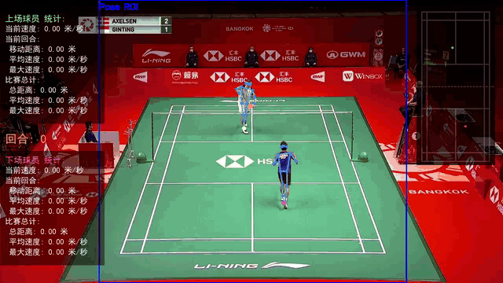
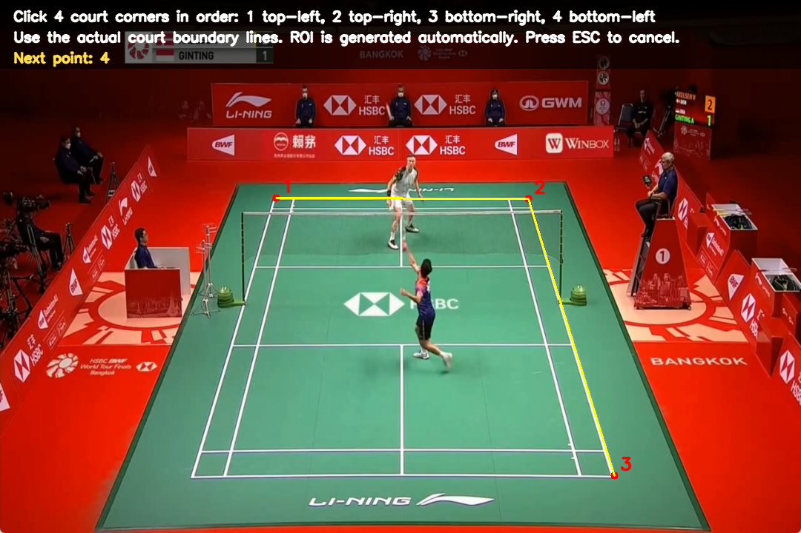
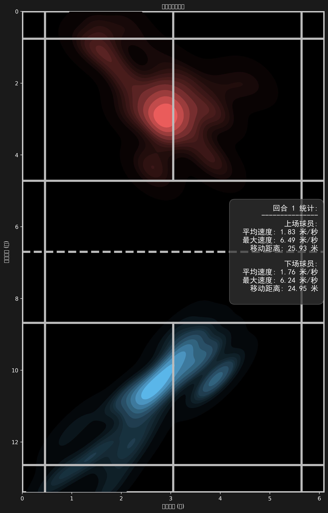
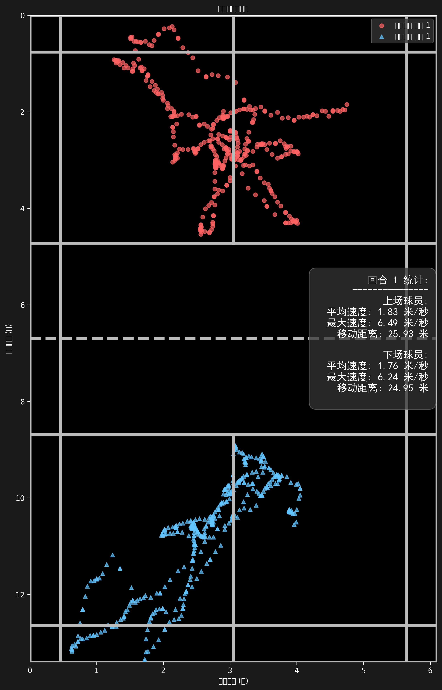

# Good-Badminton: AI Badminton Hawk-Eye System 🏸

<div align="center">

[](https://github.com/yo-WASSUP/Good-Badminton/stargazers)
[](https://github.com/yo-WASSUP/Good-Badminton/network/members)
[](https://github.com/yo-WASSUP/Good-Badminton/blob/main/LICENSE)

**A computer-vision toolkit for badminton match video analysis**

[中文](README.md) | [English](README_EN.md)

</div>

## 🎬 Preview



Video preview: `assets/demo.mp4`.

## 🆕 Changelog

- **2026-06-20**: Initial open-source release.
- **2026-06-17**: Project documentation cleanup.
- **Current version**: Supports player pose detection, shuttlecock detection, court coordinate mapping, trajectory statistics, heatmaps, scatter plots, and annotated video output.
- **Experimental features**: Hit-point analysis and stroke statistics are still under active iteration and are mainly intended for research and secondary development.

## 🔮 Roadmap

- [x] Frame-by-frame badminton match video analysis
- [x] RTMPose / RTMO / YOLO Pose model support
- [x] YOLO shuttlecock detection model integration
- [x] Manual court annotation and court coordinate mapping
- [x] Player movement trajectory, speed, distance, and rally statistics
- [x] Chinese / English visualization text
- [x] Heatmap, scatter plot, and detection data export
- [ ] More stable hit-point recognition
- [ ] More accurate shuttlecock detection model
- [ ] More complete stroke statistics
- [ ] Automatic court keypoint detection
- [ ] Batch video analysis workflow

---

## ✨ Features

- **Player pose detection** - Supports RTMPose, RTMO, and Ultralytics YOLO Pose for human keypoint and skeleton detection.
- **Shuttlecock detection** - Uses a YOLO model to detect shuttlecock positions and draw trajectories in the output video.
- **Court coordinate mapping** - Manually annotates court keypoints and maps image coordinates to standard badminton court coordinates.
- **Player position tracking** - Tracks upper-court and lower-court players separately and records movement trajectories.
- **Rally detection** - Detects rally start/end states from continuous court-view matching and records rally IDs in overlays and detection data.
- **Motion statistics** - Computes movement distance, current speed, maximum speed, and rally counts.
- **Visual output** - Generates annotated videos with skeletons, trajectories, statistics, and court trajectory overlays.
- **Position charts** - Automatically generates player position heatmaps and scatter plots.
- **Chinese / English display** - Switch visualization text with `--language zh/en`.
- **Local execution** - Videos, models, and analysis results stay on your local machine.

## 📋 Requirements

- Python 3.8+
- FFmpeg available in system `PATH`
- OpenCV / PyTorch / Ultralytics / RTMLib / ONNX Runtime
- NVIDIA GPU is recommended. CPU execution works, but video analysis will be much slower.
- Shuttlecock YOLO weight `weights/yolo11s-ball.pt`, downloaded from the project GitHub Release.

## 🚀 Installation

The default dependencies use CPU PyTorch and ONNX Runtime.

### Windows

```bash
python -m venv .venv
.\.venv\Scripts\activate
python -m pip install --upgrade pip
pip install -r requirements.txt
```

### Linux / macOS

```bash
python -m venv .venv
source .venv/bin/activate
python -m pip install --upgrade pip
pip install -r requirements.txt
```

### GPU Acceleration (Windows / NVIDIA)

Prerequisites:

- NVIDIA driver installed, and `nvidia-smi` works correctly.
- CUDA 12.1 PyTorch wheels are recommended.
- If DLL loading fails, install or repair Microsoft Visual C++ Redistributable 2015-2022 x64.

PowerShell:

```bash
.\.venv\Scripts\activate

pip uninstall -y torch torchvision onnxruntime onnxruntime-gpu
pip install torch==2.5.1+cu121 torchvision==0.20.1+cu121 --index-url https://download.pytorch.org/whl/cu121
pip install onnxruntime-gpu==1.20.1
```

Verify GPU availability:

```bash
python -c "import torch; print('torch:', torch.__version__); print('cuda:', torch.cuda.is_available()); print('gpu:', torch.cuda.get_device_name(0) if torch.cuda.is_available() else 'not available')"
python -c "import onnxruntime as ort; print(ort.__version__); print(ort.get_available_providers())"
```

Expected output includes:

```text
cuda: True
CUDAExecutionProvider
```

> Note: after installing GPU ONNX Runtime, `pip check` may report `rtmlib requires onnxruntime, which is not installed`. If provider verification shows `CUDAExecutionProvider`, do not reinstall CPU `onnxruntime`, because it may overwrite the GPU package.

Switch back to CPU dependencies:

```bash
pip install --force-reinstall -r requirements.txt
```

## 📦 Model Preparation

Shuttlecock detection uses the YOLO weight released by this project. Download `yolo11s-ball.pt` from GitHub Releases:

```text
https://github.com/yo-WASSUP/Good-Badminton/releases
```

Place it at:

```text
weights/yolo11s-ball.pt
```

RTMPose / RTMO can use local ONNX model files:

```text
weights/yolox_nano_8xb8-300e_humanart-40f6f0d0.onnx
weights/rtmpose-s_simcc-body7_pt-body7_420e-256x192-acd4a1ef_20230504.onnx
weights/rtmo-s_8xb32-600e_body7-640x640-dac2bf74_20231211.onnx
```

If local RTMPose / RTMO files are missing, `rtmlib` may try to download them into the user cache directory.

## 📝 Usage

### Basic Run

```bash
python main.py --video-path videos/demo.mp4
```

### First Run Workflow

1. Prepare the input video and shuttlecock detection weight.
2. Run the basic command:

```bash
python main.py --video-path videos/demo.mp4
```

3. If `--template-path` is not provided, the program opens a file picker for a court template image. Usually, choose a stable frame with clear court lines.
4. The court annotation window opens. Follow the prompt at the top of the image and click the four court corners in order: top-left, top-right, bottom-right, bottom-left.



5. After the four points are selected, the window shows a green court box and a blue pose-detection ROI. The ROI is generated automatically from the court area.
6. The annotation is saved to `results/<video_name>/court_annotations.txt`. Re-running with the same output directory reuses this file.
7. After analysis finishes, check `results/<video_name>/detect_<video_name>.mp4`, `detections.jsonl`, and `position_visualizations/`.

Why four court points are required:

- The four corners establish the mapping from image coordinates to standard badminton court coordinates.
- Player filtering mainly depends on court coordinates, which helps remove spectators, referees, and people outside the court.
- Upper/lower court player assignment, movement distance, speed, rally statistics, heatmaps, and scatter plots all depend on this mapping.
- Rally detection uses court template matching: consecutive court-view frames start a rally, and consecutive non-court-view frames end it.
- The pose ROI only reduces the inference area and improves speed. It is automatically expanded from the court area.
- Shuttlecock detection still runs on the full frame, with basic filtering based on the horizontal court range plus padding.

If the video angle, crop, or template image changes, delete the corresponding `court_annotations.txt` and annotate the four points again.

### Rally Detection

The program uses the court template image to detect the match view and maintain rally state automatically:

- Consecutive frames matching the court view start a new rally.
- Consecutive frames not matching the court view end the current rally.
- Rally IDs are written to `detections.jsonl` and displayed in the output video statistics overlay.
- Per-rally movement distance and speed statistics reset at the start of each rally. Full-match statistics keep accumulating.
- This logic depends on the template image and four-point court annotation. Poor template selection can cause inaccurate rally segmentation.

### Pose Model Selection

```bash
# Default: two-stage RTMPose balanced
python main.py --video-path videos/demo.mp4 --pose-family rtmpose --pose-mode balanced

# Lighter one-stage RTMO
python main.py --video-path videos/demo.mp4 --pose-family rtmo --pose-mode lightweight

# Use Ultralytics YOLO Pose
python main.py --video-path videos/demo.mp4 --pose-family yolo-pose --yolo-pose-model yolo11n-pose.pt
```

RTMPose / RTMO modes:

- `lightweight`: prioritizes speed.
- `balanced`: default tradeoff between speed and quality.
- `performance`: larger model, slower, usually better for detection quality.

### Common Arguments

```text
--video-path                 Input video path, required
--output-dir                 Output directory, default results/<video_name>
--ball-model                 YOLO shuttlecock detection model path, default weights/yolo11s-ball.pt
--pose-family                Pose model family: rtmpose, rtmo, or yolo-pose
--pose-mode                  RTMPose / RTMO mode: lightweight, balanced, performance
--yolo-pose-model            YOLO pose model path or model name, default yolo11n-pose.pt
--template-path              Court template image path; opens a file picker if omitted
--pose-roi true|false                Show pose-detection ROI box, default true
--display true|false                 Show OpenCV preview window, default true
--skeletons true|false               Show human skeletons, default true
--player-trajectories true|false     Show player trajectories, default true
--court-trajectory true|false        Show court trajectory overlay, default true
--shuttlecock-trajectory true|false  Show shuttlecock trajectory, default true
--player-stats true|false            Show player statistics, default true
--performance-stats                  Print performance timings
--save-images                        Save processed frame images
--visualize-positions true|false     Generate heatmaps and scatter plots, default true
--audio true|false                   Keep original video audio, default true
--language {zh,en}                   Visualization language
```

## 📊 Outputs

Default output directory: `results/<video_name>/`.

- `metadata.json`: metadata for video, models, court annotation, and output files.
- `detections.jsonl`: per-frame detection records, including rally ID, players, hands, court coordinates, speed, and shuttlecock coordinates.
- `detect_<video_name>.mp4`: annotated output video with skeletons, trajectories, statistics, and rally IDs.
- `court_annotations.txt`: cached court annotation coordinates.
- `position_visualizations/heatmaps/`: player position heatmaps.
- `position_visualizations/scatter_plots/`: player position scatter plots.

### Position Visualization Examples

| Heatmap | Scatter Plot |
| --- | --- |
|  |  |

## 🧩 Project Structure

```text
main.py              # CLI entry and argument parsing; keeps python main.py ... usage
badminton_analysis/
├── system.py        # Main video analysis pipeline: BadmintonAnalysisSystem
├── court/           # Court annotation and coordinate mapping
├── data/            # JSON / JSONL output
├── detection/       # Shuttlecock detection and pose detection
├── media/           # Video/audio processing
├── tracking/        # Player tracking
└── visualization/   # Video overlays, statistics charts, and position plots
```

## 🙏 Acknowledgements

Thanks to the TrackNetV2 badminton dataset, the RTMPose human pose estimation project, and Ultralytics.

